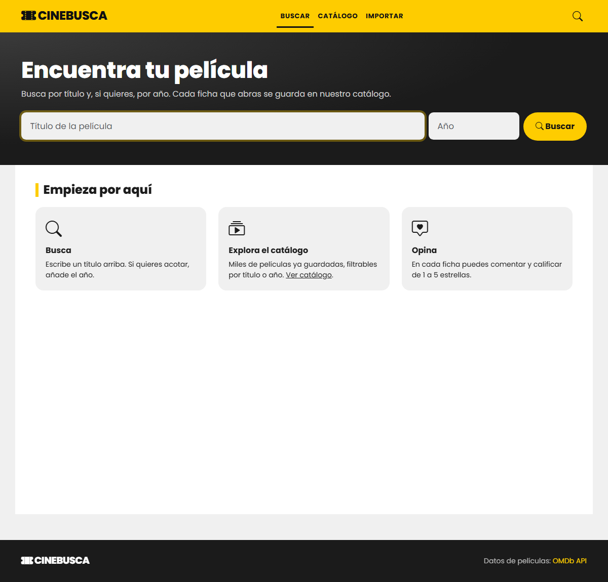
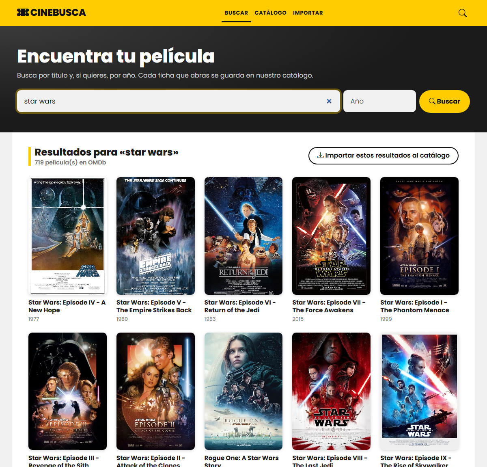
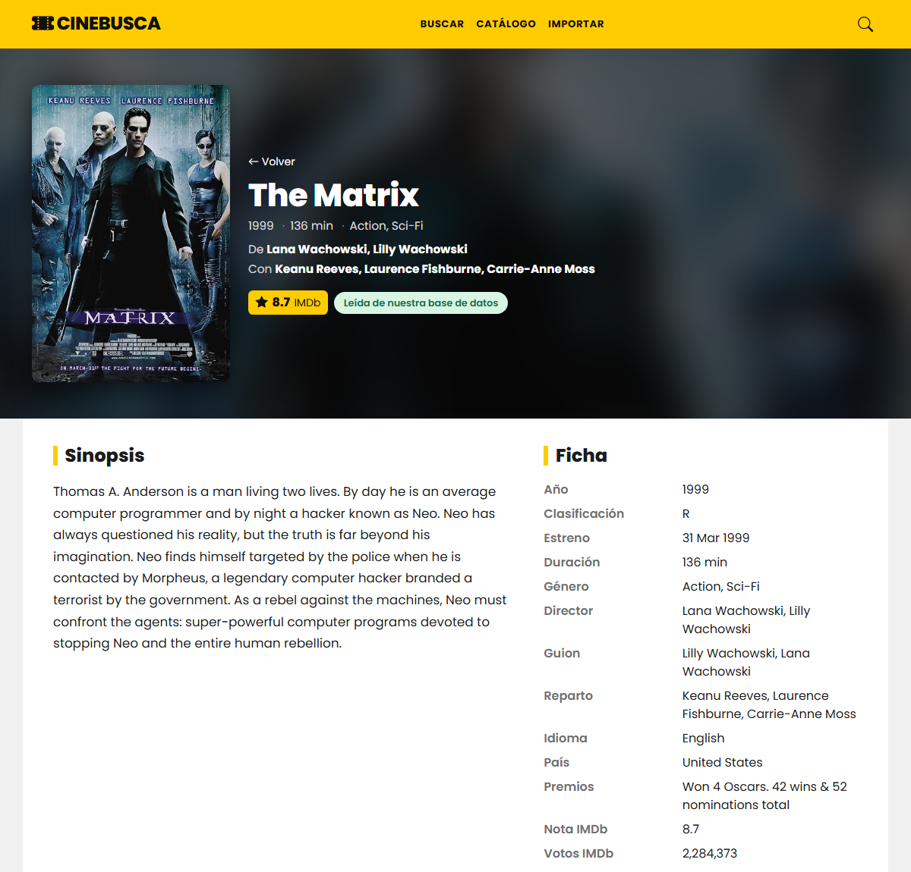
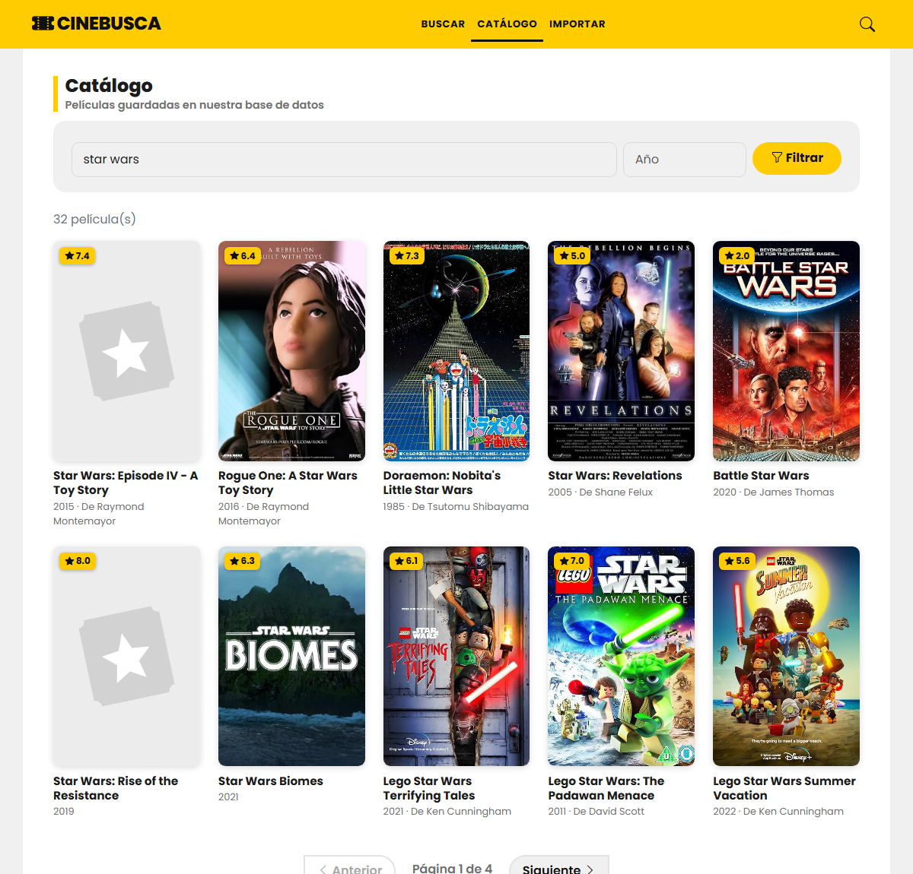
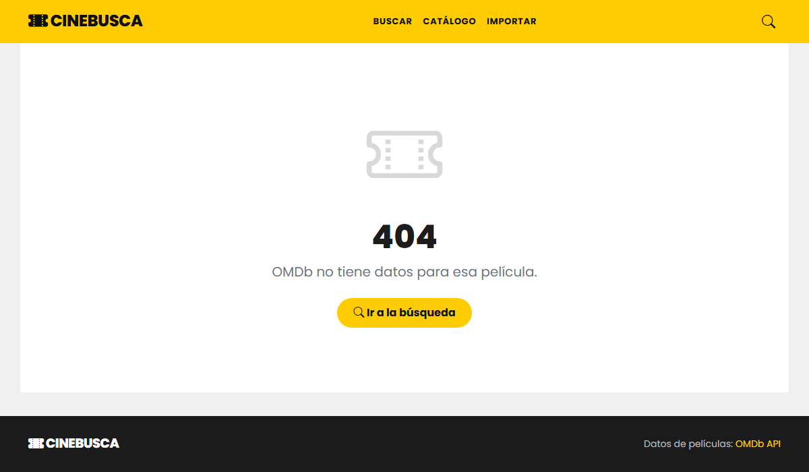
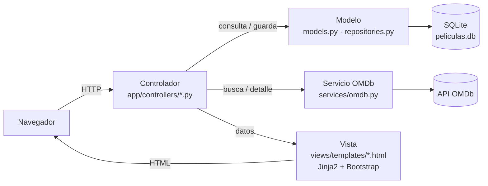
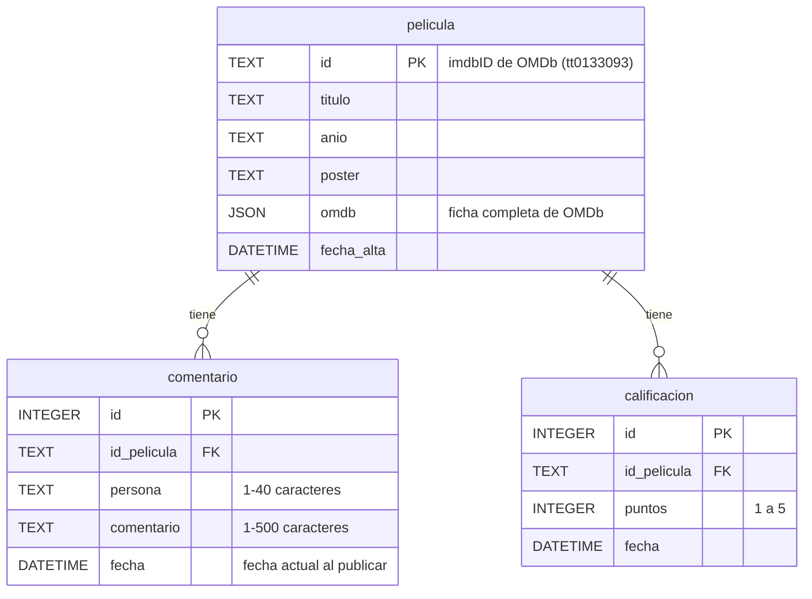

# 🎬 CineBusca — Buscador de películas con OMDb

> Proyecto final de curso · **FastAPI + SQLite + Bootstrap** · arquitectura **MVC**
> Autor: Hugo Toledo Castro

Aplicación web para **buscar películas por título y año**, **ver el detalle** de cada una, **comentarla** y **calificarla de 1 a 5 estrellas**, con el promedio de todas las calificaciones mostrado en estrellas. Los datos de las películas vienen de la API pública de [OMDb](https://www.omdbapi.com/); los comentarios y calificaciones se guardan en una base de datos **SQLite** propia, junto con un **catálogo** de más de 2.000 películas que se va llenando con cada ficha consultada.

---

## Índice
1. [Capturas](#capturas)
2. [Requisitos del enunciado y dónde se cumplen](#requisitos-del-enunciado-y-dónde-se-cumplen)
3. [Puesta en marcha](#puesta-en-marcha)
4. [Cómo usar la aplicación](#cómo-usar-la-aplicación)
5. [Arquitectura MVC](#arquitectura-mvc)
6. [Base de datos](#base-de-datos)
7. [Control de errores](#control-de-errores)
8. [Tests](#tests)
9. [Scripts auxiliares](#scripts-auxiliares)
10. [Decisiones de diseño](#decisiones-de-diseño)
11. [Tecnologías](#tecnologías)

---

## Capturas

| Portada y búsqueda | Resultados (título + año) |
|---|---|
|  |  |

| Detalle: ficha, calificación y comentarios | Catálogo propio con filtros |
|---|---|
|  |  |

| Página de error (404) |
|---|
|  |

---

## Requisitos del enunciado y dónde se cumplen

### Especificaciones técnicas

| Especificación | Cumplimiento |
|---|---|
| Framework **FastAPI** | [`app/main.py`](app/main.py) crea la aplicación; cada ruta es una función en [`app/controllers/`](app/controllers/) |
| Base de datos **SQLite** | Archivo [`peliculas.db`](peliculas.db) gestionado con SQLAlchemy ([`app/database.py`](app/database.py), [`app/models.py`](app/models.py)) |
| Framework CSS **Bootstrap** | Bootstrap 5.3 + Bootstrap Icons en todas las plantillas ([`app/views/templates/`](app/views/templates/)); estilos propios en [`app/static/styles.css`](app/static/styles.css) |
| API externa **OMDb** | Cliente en [`app/services/omdb.py`](app/services/omdb.py); la API key se lee del archivo `.env` |
| Patrón **MVC** | Modelo (`models.py`, `repositories.py`) · Vista (`views/templates/`) · Controlador (`controllers/`). Ver [Arquitectura MVC](#arquitectura-mvc) |
| **Control de errores** | Manejadores centralizados en `main.py`, errores de OMDb traducidos, validación de formularios y restricciones en la base. Ver [Control de errores](#control-de-errores) |

### Historias de usuario

| # | Historia | Dónde |
|---|---|---|
| 1 | Buscar películas por título | Portada (`GET /?title=…`) → OMDb |
| 2 | Buscar películas por año para obtener listados de un año | En la portada, título + año en OMDb (`&year=…`). En el **Catálogo**, solo el año (`GET /catalog?year=1999`) devuelve el listado completo de ese año desde nuestra base |
| 3 | Clic en un resultado → detalle ampliado | Cada tarjeta enlaza a `GET /movies/{imdb_id}`: póster, sinopsis completa, director, guion, reparto, género, duración, país, premios, notas IMDb/Metascore, taquilla |
| 4 | Registrar comentarios desde la vista de detalle | Formulario en el detalle → `POST /movies/{imdb_id}/comments` |
| 5 | Ver todos los comentarios de la película en su detalle | Se listan bajo el formulario, los más recientes primero, leídos de SQLite |
| 6 | Calificar de 1 a 5 y ver el promedio en estrellas | Estrellas para votar → `POST /movies/{imdb_id}/ratings`; promedio en estrellas (con medias estrellas), valor numérico y número de votos |

### Tabla `Comentario` (SQLite)

El enunciado pide una tabla **Comentario** con `id (int)`, `id_pelicula`, `persona (str)`, `comentario (str)` y `fecha (date)`:

| Columna | Tipo | Contenido |
|---|---|---|
| `id` | INTEGER, clave primaria autoincremental | Identificador del comentario |
| `id_pelicula` | TEXT, clave foránea a `pelicula.id` | **El `imdbID` que devuelve el API** (p. ej. `tt0133093`): relaciona nuestros datos con los de OMDb |
| `persona` | TEXT (1–40 caracteres) | Nombre de quien comenta ("Anónimo" si se deja vacío) |
| `comentario` | TEXT (1–500 caracteres) | Texto del comentario |
| `fecha` | DATETIME | **Fecha y hora actuales** en el momento de publicar (se rellena automáticamente) |

> `id_pelicula` se guarda como texto y no como entero porque el identificador que entrega OMDb es texto (`tt` + dígitos). Conservarlo tal cual mantiene la relación exacta con el API y con la tabla `pelicula`. Ver [Decisiones de diseño](#decisiones-de-diseño).

---

## Puesta en marcha

Requiere **Python 3.11 o superior** ([descarga](https://www.python.org/downloads/), marcando *Add python.exe to PATH*).

### Opción A · Doble clic (Windows)
Ejecuta **`iniciar.bat`**. La primera vez crea el entorno virtual, instala las dependencias y crea el archivo `.env`; después abre el navegador en http://localhost:8000.

### Opción B · Manual
```powershell
git clone https://github.com/hugotc-creator/app_peliculas_KC.git
cd app_peliculas_KC

python -m venv .venv
.venv\Scripts\activate            # en Linux/macOS: source .venv/bin/activate
pip install -r requirements.txt

copy .env.example .env             # y escribe tu API key de OMDb en OMDB_API_KEY=

uvicorn app.main:app --reload
```
Abre http://localhost:8000.

### API key de OMDb
Se obtiene gratis en https://www.omdbapi.com/apikey.aspx (1.000 peticiones al día). Se escribe en el archivo **`.env`**:
```
OMDB_API_KEY=tu_clave
```
`.env` está en `.gitignore`: la clave nunca se sube al repositorio. Sin clave, la aplicación avisa en lugar de fallar: el **catálogo** y los **detalles de las películas ya guardadas** (más de 2.000, incluidas en `peliculas.db`) funcionan igualmente; solo la búsqueda en OMDb queda deshabilitada.

---

## Cómo usar la aplicación

| Ruta | Método | Qué hace |
|---|---|---|
| `/` | GET | Portada con buscador. Con `?title=…&year=…&page=…` consulta OMDb y muestra resultados paginados |
| `/movies/{imdb_id}` | GET | Detalle de la película. Si no está en nuestra base, se pide a OMDb y **se guarda**; si está, se lee de SQLite (una etiqueta indica el origen) |
| `/movies/{imdb_id}/comments` | POST | Publica un comentario (`author`, `text`) y redirige al detalle |
| `/movies/{imdb_id}/ratings` | POST | Registra una calificación (`value` de 1 a 5) y redirige al detalle |
| `/catalog` | GET | Catálogo de películas guardadas, con filtro por título y/o año (`?title=…&year=…`) y paginación |
| `/import` | GET / POST | Importación en lote: guarda en el catálogo todos los resultados de una búsqueda de OMDb (1 a 10 páginas) |
| `/static/…` | GET | CSS, favicon y póster de relleno |

---

## Arquitectura MVC



- **Modelo** — [`app/models.py`](app/models.py) define las tablas (`Pelicula`, `Comentario`, `Calificacion`) con SQLAlchemy; [`app/repositories.py`](app/repositories.py) concentra todas las consultas (`MovieRepository`). Las reglas puras (promedio, estrellas, validación de comentarios, parseo de OMDb) están en [`app/core.py`](app/core.py), sin dependencias de base de datos ni HTTP.
- **Vista** — plantillas Jinja2 en [`app/views/templates/`](app/views/templates/): `base.html` (cabecera, pie), `search.html`, `detail.html`, `catalog.html`, `import.html`, `error.html` y `_macros.html` (tarjetas, paginación, estrellas). Todo el texto se escapa automáticamente (sin inyección de HTML).
- **Controlador** — un módulo por área en [`app/controllers/`](app/controllers/): `search.py`, `movies.py` (detalle, comentarios, calificaciones), `catalog.py`, `imports.py`. Reciben la petición, usan el modelo y los servicios y eligen la vista.
- **Servicios** — [`app/services/omdb.py`](app/services/omdb.py) (cliente de la API externa) y [`app/services/importer.py`](app/services/importer.py) (importación en lote).

### Estructura del proyecto
```
app/
  main.py               Arranque de FastAPI, archivos estáticos y manejadores de errores
  config.py             Configuración desde .env (API key, URL de la base de datos)
  database.py           Conexión SQLite con SQLAlchemy
  dependencies.py       Inyección de dependencias (sesión de BD, cliente OMDb)
  core.py               Funciones puras: parseo de OMDb, promedio, estrellas, validación
  models.py             MODELO: tablas pelicula, comentario, calificacion
  repositories.py       MODELO: consultas a la base (MovieRepository)
  services/omdb.py      Cliente de la API OMDb (errores traducidos)
  services/importer.py  Importación en lote
  controllers/          CONTROLADORES: search, movies, catalog, imports
  views/templates/      VISTAS: Jinja2 + Bootstrap
  static/               styles.css, favicon.svg, no-poster.svg
docs/screenshots/       Capturas de pantalla
scripts/                Carga masiva y migración de datos
tests/                  pytest: funciones puras, cliente OMDb y pruebas HTTP de extremo a extremo
peliculas.db            Base de datos SQLite (incluida con el catálogo lleno)
iniciar.bat             Arranque con doble clic en Windows
requirements.txt        Dependencias con versiones fijadas
.env.example            Plantilla de configuración
```

---

## Base de datos

Un único archivo **`peliculas.db`** en la raíz del proyecto, con tres tablas:



- **`pelicula`**: cada ficha que se consulta se guarda con la respuesta completa de OMDb en la columna `omdb` (JSON), más las columnas que se usan para listar y filtrar. El repositorio incluye **2.261 películas** ya cargadas.
- **`comentario`** y **`calificacion`**: relacionadas con `pelicula` por `id_pelicula` (clave foránea con borrado en cascada). Las restricciones `CHECK` impiden comentarios vacíos o puntuaciones fuera de 1–5 incluso si se intentara saltar la validación de la aplicación.
- Las tablas se crean solas al arrancar si no existen (`init_db()` en `app/database.py`).

Para explorarla se puede usar [DB Browser for SQLite](https://sqlitebrowser.org/) (*File → Open Database → peliculas.db*) o la extensión *SQLite Viewer* de VS Code. Ejemplo de consulta:
```sql
SELECT c.persona, c.comentario, c.fecha, p.titulo
FROM comentario c JOIN pelicula p ON p.id = c.id_pelicula
ORDER BY c.fecha DESC;
```

---

## Control de errores

| Situación | Qué ocurre |
|---|---|
| OMDb no responde, clave inválida o cuota diaria agotada | `OmdbError` en `services/omdb.py` → página de error **502/500** con el mensaje traducido ("Se alcanzó el límite diario de peticiones a OMDb", "API key de OMDb inválida"...) |
| Búsqueda sin resultados o demasiado genérica | Mensaje dentro de la propia página de búsqueda (no es un error de la aplicación) |
| Identificador de película inexistente | Página **404** ("Identificador de película incorrecto.") |
| Comentario vacío o demasiado largo | **422**: el formulario se vuelve a mostrar con el mensaje junto al campo y el texto escrito |
| Calificación fuera de 1–5 o no numérica | **422** con mensaje; además la base la rechaza por `CHECK` |
| Parámetros inválidos en la URL (p. ej. `page=abc`) | **422** con página de error |
| Ruta inexistente / método no permitido | **404 / 405** con página de error |
| Cualquier excepción no prevista | **500** con página de error; el detalle queda en el log del servidor |
| Falta la API key en `.env` | Aviso claro en lugar de un fallo silencioso |

Todos los manejadores están centralizados en [`app/main.py`](app/main.py) y renderizan la misma plantilla `error.html` con Bootstrap. Las vistas escapan todo el texto, así que un comentario con HTML se muestra como texto plano.

---

## Tests

```powershell
pytest
```
**36 pruebas** en [`tests/`](tests/), sin red ni API key (SQLite en memoria y cliente OMDb simulado):
- `test_core.py` — funciones puras: parseo de OMDb, paginación, promedio, estrellas, validación de comentarios.
- `test_omdb.py` — cliente OMDb contra respuestas HTTP simuladas: búsqueda, detalle, "no encontrada", cuota agotada, clave inválida, red caída, clave ausente.
- `test_app.py` — pruebas de extremo a extremo (HTTP → controlador → modelo → vista): búsqueda, detalle con guardado en SQLite, comentarios (guardado, escape de HTML, validación), calificaciones (promedio y estrellas), catálogo (filtros y paginación), importación y páginas de error.

---

## Scripts auxiliares

| Script | Uso |
|---|---|
| `scripts/seed_movies.py` | Carga masiva de películas desde OMDb: `python scripts/seed_movies.py --target 1500`. Salta las ya guardadas y se detiene al agotar la cuota diaria; se puede repetir otro día |
| `scripts/migrate_supabase.py` | Copia datos de una versión anterior del proyecto (Supabase) a SQLite |

---

## Decisiones de diseño

- **`id_pelicula` como texto.** OMDb identifica las películas con `imdbID` (`tt0133093`). Guardarlo tal cual, en vez de convertirlo a entero, mantiene la relación exacta con el API y evita conversiones al leer y escribir.
- **Catálogo propio.** Cada detalle consultado se guarda en SQLite. Así la aplicación tiene su propia base de datos de películas, permite buscar solo por año (algo que la API de OMDb no admite) y reduce las peticiones a OMDb.
- **Base de datos incluida en el repositorio.** `peliculas.db` se versiona para que, al clonar, el catálogo ya esté lleno y la aplicación pueda evaluarse incluso sin API key.
- **La API key fuera del código.** Vive en `.env` (ignorado por Git); `.env.example` documenta qué rellenar.
- **Cuota de OMDb.** El plan gratuito permite 1.000 peticiones al día. La importación en lote y el script de carga comprueban primero qué películas ya existen para no gastar peticiones en ellas.
- **Funciones puras separadas.** Las reglas de negocio (`core.py`) no dependen de FastAPI ni de la base de datos, lo que las hace fáciles de probar.

---

## Tecnologías

| | |
|---|---|
| Backend | [FastAPI](https://fastapi.tiangolo.com/) 0.159 · [Uvicorn](https://www.uvicorn.org/) |
| Base de datos | SQLite · [SQLAlchemy](https://www.sqlalchemy.org/) 2 |
| Vistas | [Jinja2](https://jinja.palletsprojects.com/) · [Bootstrap](https://getbootstrap.com/) 5.3 · [Bootstrap Icons](https://icons.getbootstrap.com/) · tipografía Poppins |
| API externa | [OMDb API](https://www.omdbapi.com/) vía [httpx](https://www.python-httpx.org/) |
| Configuración | [pydantic-settings](https://docs.pydantic.dev/latest/concepts/pydantic_settings/) (`.env`) |
| Tests | [pytest](https://docs.pytest.org/) · `fastapi.testclient` |

El diseño visual (cabecera amarilla, títulos con barra lateral, pósters con sombra, pie oscuro) está inspirado en portales de cine como SensaCine.
